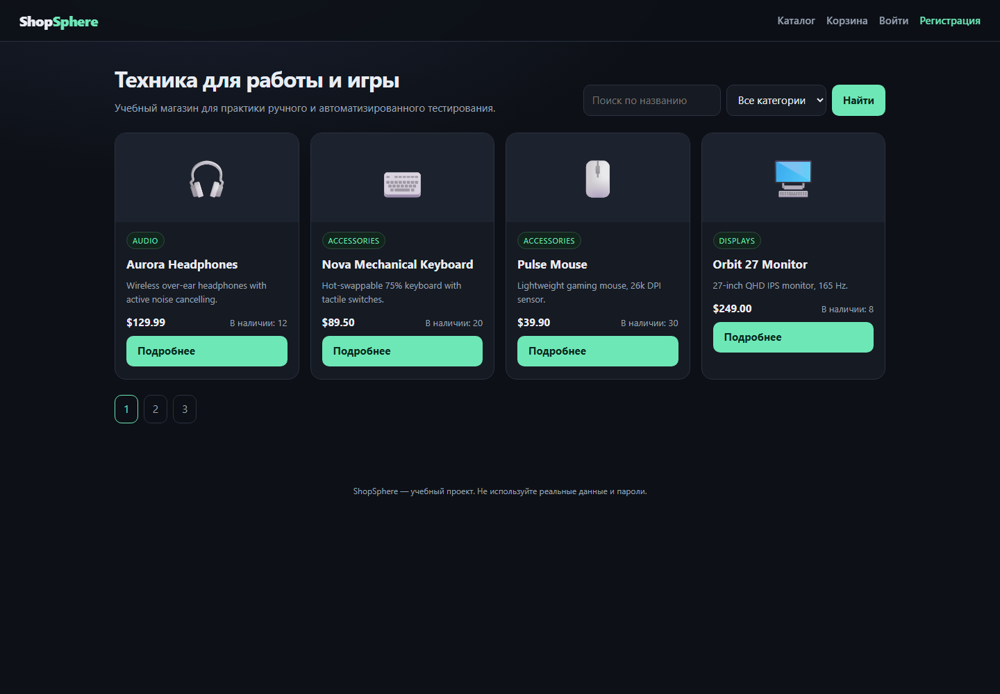

# QA Fullstack Lab

Учебная лаборатория для полного цикла тестирования: ручное тестирование → API → UI-автоматизация → Java → CI/CD → GitHub-процессы.

Пользователь: ручной QA с 3+ годами опыта, без опыта в автоматизации и без знания Python/Java.



## Что внутри

| Папка | Что это |
|---|---|
| `apps/shopsphere/` | Учебный интернет-магазин: FastAPI + SQLite + Jinja2. С намеренными багами. |
| `tests/python/` | pytest: API-тесты, UI-тесты Playwright, тесты известных багов (`xfail`). |
| `tests/java/` | Maven + JUnit 5 + RestAssured + Selenium. |
| `.github/workflows/` | CI для Python и Java. |
| `docs/` | Роадмап, программы, шаблоны, список багов. |
| `scripts/` | Запуск, сиды, установка. |

## Быстрый старт

```powershell
cd D:\OpenCode_Projects\QA_Fullstack_Lab
python -m venv .venv
.\.venv\Scripts\Activate.ps1
pip install -r requirements.txt
uvicorn apps.shopsphere.main:app --reload --port 8000
```

Открыть http://127.0.0.1:8000.

### Тестовые пользователи

| Роль | Email | Пароль |
|---|---|---|
| Админ | `admin@shopsphere.local` | `Admin123!` |
| Пользователь | `alice@example.com` | `User123!` |
| Пользователь | `bob@example.com` | `User123!` |

## Тесты

```powershell
# все Python-тесты (API + известные баги)
pytest -q

# только API
pytest -q tests/python/test_api_shopsphere.py

# UI Playwright (нужен браузер)
playwright install chromium
pytest -q tests/python/test_ui_shopsphere.py -m ui
```

Java (после установки JDK 21 + Maven):

```powershell
mvn -f tests/java/pom.xml test
```

## CI

GitHub Actions:
- `Python tests` — pytest на каждый push/PR.
- `Java tests` — поднимает приложение, запускает Maven-тесты.

## Документы

- [Роадмап](docs/ROADMAP.md)
- [Программы](docs/PROGRAMS.md)
- [Пет-проекты](docs/PET_PROJECTS.md)
- [Git и CI](docs/GIT_CI.md)
- [Ручное тестирование](docs/MANUAL_TESTING.md)
- [Заложенные баги](docs/INSTRUCTOR_BUGS.md) — не открывать до самостоятельного прохождения.

## Правила

- Учебные задания — в feature-ветках и через PR.
- `main` и `develop` не трогать напрямую.
- Секреты не коммитить.
